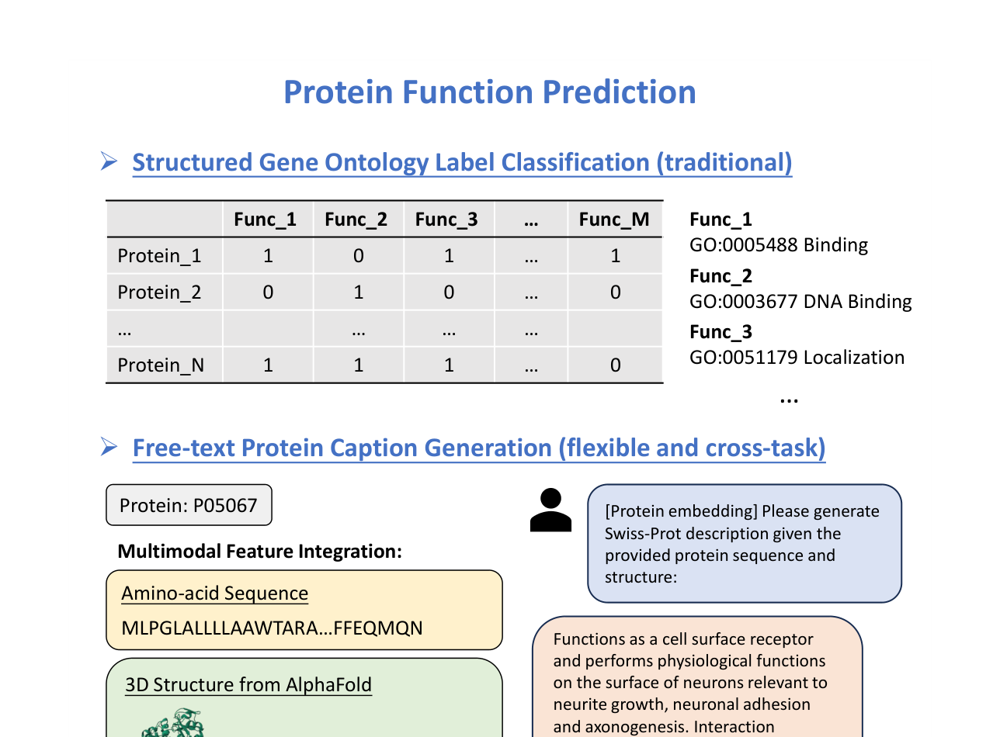
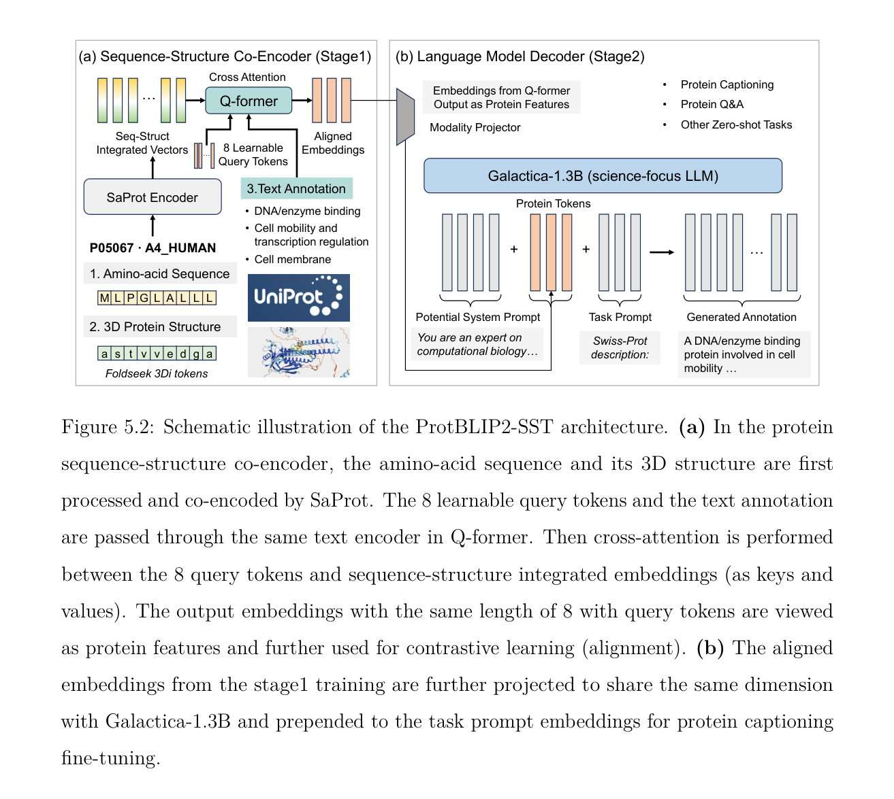
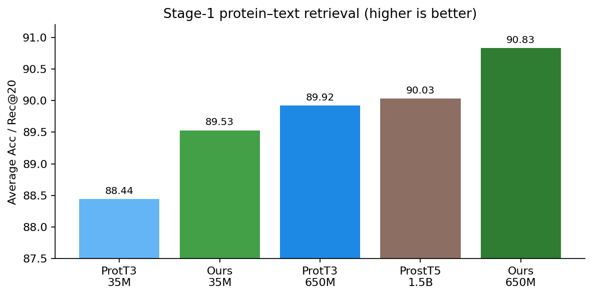
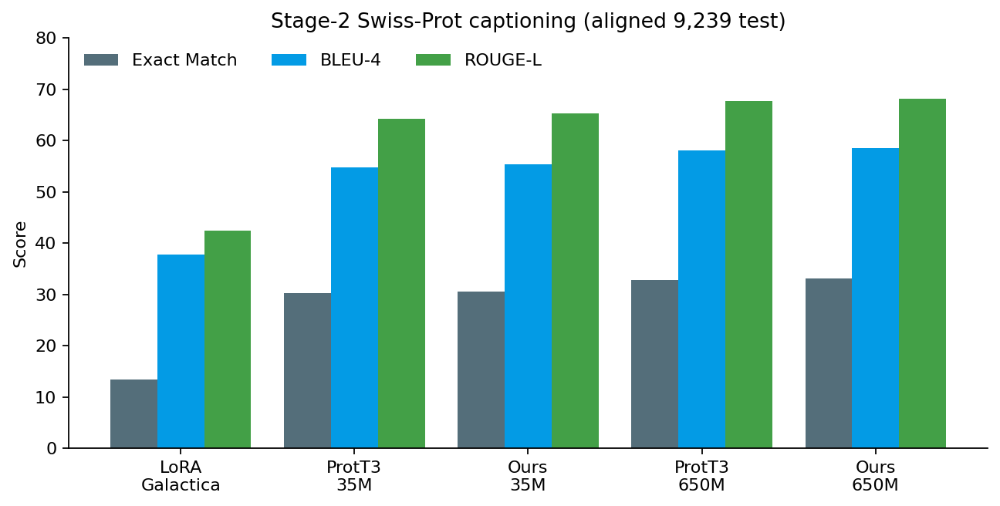
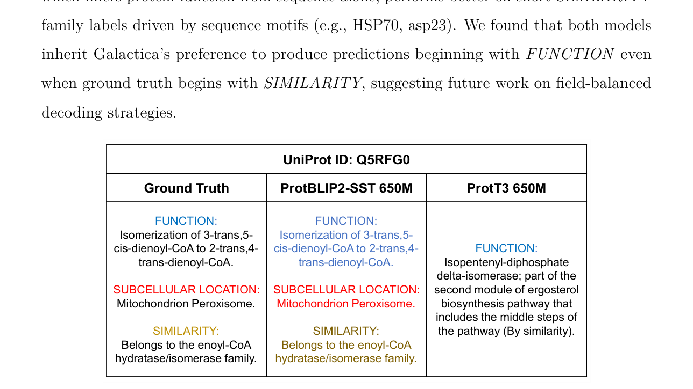

# ProtBLIP2-SST

**Protein Function Prediction via BLIP-2 with Sequence, Structure, and Text**

ProtBLIP2-SST turns protein function prediction from fixed Gene Ontology multi-label classification into **open-ended Swiss-Prot caption generation**, jointly using amino-acid sequence, AlphaFold structure, and free-text annotations.

<p align="center">
  
</p>
<p align="center"><em>Figure: traditional GO label matrices vs multimodal free-text captioning (sequence + AlphaFold structure → Swiss-Prot description).</em></p>

We keep a frozen protein encoder, an **8-query Q-Former**, and **Galactica-1.3B** (mid-layer LoRA) fixed, and swap only the protein language model (PLM):

| Variant | PLM | Input |
|---------|-----|--------|
| SST-ESM (ProtT3-style) | ESM-2 35M / 650M | amino-acid sequence |
| **SST-SaProt (ours)** | SaProt AF2 35M / 650M | interleaved AA + Foldseek 3Di |
| SST-ProstT5 | ProstT5 (~1.5B) | bilingual sequence–structure T5 |

**Stage 1** aligns protein and text (PTC / PTM / PCap). **Stage 2** generates Swiss-Prot-style captions (`FUNCTION:`, `SUBCELLULAR LOCATION:`, `SIMILARITY:`).

On an **aligned 9,239-sample** AlphaFold-filtered test split, **ProtBLIP2-SST (SaProt-650M)** reaches **33.07% exact match**, **58.53 BLEU-4**, **68.23 ROUGE-L**, and **69.54 METEOR**, ahead of ESM-2-650M under identical training (32.83 / 58.12 / 67.77 / 69.10). Structure conditioning reduces fold-specific enzyme confusions; sequence-only encoding remains stronger on short homology labels.

> Built on [ProtT3](https://github.com/georgedashen/ProtT3) / BLIP-2 ([Liu et al., ACL 2024](https://openreview.net/forum?id=ZmIjOPil2b)). This is an independent SST extension.

Manuscript: [`paper/`](paper/) · thesis chapter source notes: [`manuscripts/conference.tex`](manuscripts/conference.tex) · analysis: [`analysis/`](analysis/) · tabulated results: [`results/`](results/)

---

## Architecture

<p align="center">
  
</p>

**(a) Stage 1 — sequence–structure co-encoder.** SaProt co-encodes amino acids and Foldseek 3Di tokens into integrated vectors. An 8-query Q-Former cross-attends to these vectors and aligns with biomedical text via contrastive (PTC), matching (PTM), and captioning (PCap) losses.

**(b) Stage 2 — language model decoder.** Aligned 8-token protein features are projected into Galactica-1.3B and prepended to the prompt `Swiss-Prot description:` for LoRA caption finetuning (and related protein–text tasks).

---

## Highlights (from thesis Ch.5)

1. **Unified SST captioning** — one BLIP-2 skeleton, interchangeable ESM-2 / SaProt / ProstT5 encoders.
2. **AlphaFold-filtered Swiss-Prot V3** — ~411K train / 9.2K test with paired `_afdbfilt` and `_saprot` splits.
3. **Strongest matched-training variant** — SaProt-650M tops Stage-1 retrieval (avg **90.83**) and Stage-2 n-gram metrics.
4. **Field-aware analysis** — structure helps `FUNCTION:` disambiguation most; ESM-2 competitive on short `SIMILARITY:` motifs.
5. **Cached PLM embeddings + FlashAttention** — up to ~12× Stage-1 speedup on structure-heavy encoders (A100).

---

## Results

### Stage 1 — protein–text retrieval

Average of Acc / Rec@20 (in-batch + test, P→T and T→P) after PTM re-ranking (128 candidates):

<p align="center">
  
</p>

| Encoder | In-batch P→T Acc | Test P→T Acc | Test T→P Acc | **Average** |
|---------|-----------------:|-------------:|-------------:|------------:|
| ProtT3 (ESM-2 35M) | 96.16 | 64.48 | 63.56 | 88.44 |
| ProtBLIP2-SST (SaProt 35M) | 97.10 | 66.34 | 65.47 | 89.53 |
| ProtT3 (ESM-2 650M) | 97.00 | 67.68 | 67.49 | 89.92 |
| BLIP2 + ProstT5 1.5B | 97.37 | 66.75 | 66.99 | 90.03 |
| **ProtBLIP2-SST (SaProt 650M)** | **97.94** | **69.28** | **68.70** | **90.83** |

**Stage-1 loss ablations (SaProt 35M):**

| Variant | Average |
|---------|--------:|
| w/o PTM | 89.35 |
| w/o PCap | 88.42 |
| Full (PTM + LM/PCap) | **89.53** |

Removing PCap hurts most; captioning is critical for text-relevant protein features.

### Stage 2 — Swiss-Prot captioning (aligned 9,239)

<p align="center">
  
</p>

| Model | EM | BLEU-2 | BLEU-4 | ROUGE-L | METEOR |
|-------|---:|-------:|-------:|--------:|-------:|
| LoRA finetune (Galactica) | 13.49 | 42.48 | 37.79 | 42.46 | 48.27 |
| ProtT3 (ESM-2 35M) | 30.33 | 57.86 | 54.74 | 64.29 | 65.99 |
| **ProtBLIP2-SST (SaProt 35M)** | 30.59 | 58.33 | 55.37 | 65.26 | 66.62 |
| ProtT3 (ESM-2 650M) | 32.83 | 61.01 | 58.12 | 67.77 | 69.10 |
| Prot2Text-V2* | 39.16 | 46.67 | 43.34 | 55.39 | 64.58 |
| **ProtBLIP2-SST (SaProt 650M)** | **33.07** | **61.41** | **58.53** | **68.23** | **69.54** |

\*Prot2Text-V2 uses a different backbone/split (ESM-3B + LLaMA-8B on 10k test); not a matched comparison.

**Stage-2 ablations (35M):**

| Variant | EM | BLEU-4 | ROUGE-L | METEOR |
|---------|---:|-------:|--------:|-------:|
| No finetune (marker + AA) | 0.00 | 0.58 | 6.20 | 5.11 |
| LoRA finetune (raw AA) | 24.43 | 37.15 | 53.05 | 57.40 |
| LoRA finetune (marker + AA) | 24.22 | 36.97 | 53.01 | 57.16 |
| ESM-2 hidden states (no Q-Former) | 30.92 | 43.66 | 62.91 | 64.51 |
| ProtT3 (ESM-2 + 8 queries) | 30.33 | 54.74 | 64.29 | 65.99 |
| **ProtBLIP2-SST (SaProt + 8 queries)** | **30.59** | **55.37** | **65.26** | **66.62** |

**Takeaways:** Q-Former alignment drives BLEU/ROUGE; SaProt adds a consistent gain over ESM-2; zero-shot Galactica fails even with AA markers.

### Qualitative case (structure disambiguates enzymes)

<p align="center">
  
</p>

On UniProt **Q5RFG0**, ProtBLIP2-SST-650M matches the ground-truth dienoyl-CoA isomerase caption; ProtT3-650M confuses it with an ergosterol-pathway isomerase. Across 9,239 samples, SaProt has more sole exact-match wins than ESM-2 at 35M (**316 vs 292**) and 650M (**283 vs 261**). By field (650M token-F1), SaProt leads on `FUNCTION:` / `SIMILARITY:`; ESM-2 leads on `SUBCELLULAR LOCATION:`.

Full write-up: [`analysis/saprot_vs_prott3_stage2_analysis.md`](analysis/saprot_vs_prott3_stage2_analysis.md) · win-case TSVs: [`results/stage2_main/`](results/stage2_main/)

---

## Repository layout

```
# Main paper pipeline (repo root)
stage1.py / stage1sa.py / stage1pt5.py     # Stage-1: ESM / SaProt / ProstT5
stage2.py / stage2sa.py                     # Stage-2 captioning
sa_run.sh / stage1_run.sh / stage2_sa_run.sh / pt5_*.sh / fa_run.sh
convert.py / read_results.py
model/   data_provider/

docs/figures/   # README figures (from thesis Ch.5 + metric plots)
results/  analysis/  paper/  manuscripts/  scripts/

ablations/   # AA-raw / unaligned-PLM / Stage-1 loss ablations
extras/      # Legacy ProtT3 utilities
```

Checkpoints and datasets stay local (`all_checkpoints/`, `data/`) and are gitignored.

---

## Dependencies

Python 3.8+, CUDA recommended (paper experiments: 2× A100 80GB, DeepSpeed ZeRO-2, bf16).

```bash
pip install packaging ninja
pip install flash-attn --no-build-isolation
pip install git+https://github.com/thunlp/OpenDelta.git
pip install rouge_score nltk spacy==3.7.2 salesforce-lavis
pip install -U transformers pytorch-lightning==2.1 huggingface_hub==0.25.2
pip install git+https://github.com/microsoft/DeepSpeed.git
python -c "import nltk; nltk.download('wordnet')"
```

Weights: ESM-2 (`fredzzp/esm2_*`), SaProt AF2 checkpoints, `Rostlab/ProstT5`, `facebook/galactica-1.3b`, PubMedBERT / BiomedBERT.

---

## Dataset

Swiss-Prot V3 from ProtT3 ([OSF](https://osf.io/23azs/?view_only=185575515e714f4798499bf06513a730)) → `./data`.  
We retain proteins with AlphaFold DB structures:

| Suffix | Used by | Tokenization |
|--------|---------|--------------|
| `*_afdbfilt.json` | ESM-2, ProstT5, AA-raw ablations | amino acids |
| `*_saprot.json` | SaProt | AA + lowercase 3Di |

Splits: **410,925** train / **9,236** val / **9,239** test. Stage-2 comparisons use the aligned test subset (identical captions/order across suffixes).

---

## Stage 1 — train

```bash
# SaProt (structure-aware) — also sa_run.sh
python stage1sa.py \
  --strategy deepspeed --devices '0,1' --mode train \
  --filename stage1_sa --num_query_token 8 --num_workers 8 \
  --plm_name "../SaProt/weights/PLMs/SaProt_35M_AF2" \
  --plm_tune freeze --suffix _saprot \
  --batch_size 32 --match_batch_size 64 --precision bf16-mixed \
  --max_epochs 50 --use_tb_logger --seed 42 --save_every_n_epochs 10

# ESM-2 — also stage1_run.sh / fa_run.sh
python stage1.py --strategy deepspeed --devices '0,1' --mode train \
  --filename stage1_afdbfilt --plm_name "fredzzp/esm2_t12_35M_UR50D" \
  --suffix _afdbfilt --num_query_token 8 --batch_size 32 \
  --match_batch_size 64 --precision bf16-mixed --max_epochs 50 --use_tb_logger

# ProstT5 — also pt5_run.sh
python stage1pt5.py --strategy deepspeed --devices '0,1' --mode train \
  --filename stage1_pt5 --plm_name "Rostlab/ProstT5" --suffix _afdbfilt \
  --num_query_token 8 --batch_size 32 --match_batch_size 64 \
  --precision bf16-mixed --max_epochs 50 --use_tb_logger

# Convert DeepSpeed → fp32 for Stage 2
python convert.py --input all_checkpoints/stage1_sa/epoch=49.ckpt \
                  --output all_checkpoints/stage1_sa/SaProt_35M_fp32.ckpt

# Loss ablation
bash ablations/stage1sa_ablation_35m.sh
```

Hyperparameters (shared): AdamW lr `1e-4`, weight decay `0.05`, warmup 1000 → min lr `1e-5`, 8 query tokens.

---

## Stage 2 — caption

```bash
# SaProt — also stage2_sa_run.sh
python stage2sa.py \
  --strategy deepspeed --devices '0,1' \
  --stage1_path all_checkpoints/stage1_sa/SaProt_35M_fp32.ckpt \
  --filename stage2_sa_35m_protein_captioning \
  --plm_model "../SaProt/weights/PLMs/SaProt_35M_AF2" \
  --llm_name "facebook/galactica-1.3b" \
  --llm_tune mid_lora --enable_flash --use_tb_logger \
  --root data/SwissProtV3 --suffix _saprot \
  --num_query_token 8 --batch_size 32 --max_epochs 10 \
  --precision bf16-mixed --num_workers 8 --save_every_n_epochs 10

# ESM-2 baseline under the same skeleton
python stage2.py --strategy deepspeed --devices '0,1' \
  --stage1_path /path/to/stage1_esm_fp32.ckpt \
  --filename stage2_esm_35m --llm_tune mid_lora --enable_flash \
  --root ./data/SwissProtV3 --suffix _afdbfilt \
  --num_query_token 8 --batch_size 32 --max_epochs 10 --precision bf16-mixed

python read_results.py --path /path/to/dataset0_predictions.txt
```

Stage-2: `mid_lora` (r=8, α=16), 10 epochs, beam search at eval. Ablation scripts: [`ablations/`](ablations/).

---

## Citation

If you use this code, please cite ProtT3 and the relevant PLMs. ProtBLIP2-SST citation will be updated upon publication.

```bibtex
@inproceedings{liu2024prott,
  title={ProtT3: Protein-to-Text Generation for Text-based Protein Understanding},
  author={Liu, Zhiyuan and Zhang, An and Fei, Hao and Zhang, Enzhi and Wang, Xiang and Kawaguchi, Kenji and Chua, Tat-Seng},
  booktitle={ACL},
  year={2024}
}
```

---

## Acknowledgments

Code derives from ProtT3. Dataset and pretrained weights follow their original licenses. Thanks to the authors of ProtT3, SaProt, ProstT5, ESM, Galactica, and BLIP-2. Figures in `docs/figures/` are adapted from the author’s thesis Chapter 5.
