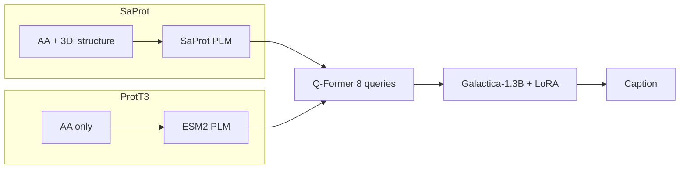

# SaProt vs ProtT3 Stage-2 Captioning Analysis

Analysis date: 2026-05-20  
Dataset: aligned **9,239** Swiss-Prot test samples (`test_set_saprot.json` / `test_set_afdbfilt.json`, identical captions and order)  
Checkpoints: `all_checkpoints/stage2_main/{sa_35m,sa_650m,prott3_35m,prott3_650m}`

## Headline metrics (re-scored from predictions)

| Model | Exact Match | BLEU-4 | ROUGE-L | METEOR |
|-------|------------:|-------:|--------:|-------:|
| ProtT3 35M (ESM2) | 30.33% | 54.74 | 64.29 | 65.99 |
| ProtT3 650M (ESM2) | 32.83% | 58.12 | 67.77 | 69.10 |
| SaProt 35M | 30.59% | 55.37 | 65.26 | 66.62 |
| SaProt 650M | 33.07% | 58.53 | 68.23 | 69.54 |

Fair head-to-head gap (BLEU-4): **+0.63** (35M) and **+0.41** (650M) in favor of SaProt.

Supporting artifacts:

- `all_checkpoints/stage2_main/sa_win_cross_size_cases.tsv` — **69** curated strong Sa wins (strict cross-size filter; see below)
- `all_checkpoints/stage2_main/prott3_win_cross_size_cases.tsv` — **45** curated strong ProtT3 wins
- Regenerate: `python scripts/export_sa_win_cross_size_cases.py`

---

## Per-sample head-to-head win counts (all 9,239)

Pairwise comparison on each test sample: SaProt vs ProtT3 at the **same encoder size** (35M or 650M).  
**Token-F1** = token-level F1 between prediction and target (same metric as the curated TSV exports).  
**Tie** = identical token-F1 (within floating-point equality).

### Exact match (Sa only vs ProtT3 only)

| Scale | SaProt wins (Sa exact, ProtT3 not) | ProtT3 wins (ProtT3 exact, Sa not) | Both exact | Neither exact |
|-------|-----------------------------------:|-----------------------------------:|-----------:|--------------:|
| **35M** | **316** (3.4%) | 292 (3.2%) | 2,510 | 6,121 |
| **650M** | **283** (3.1%) | 261 (2.8%) | 2,772 | 5,923 |

SaProt has a modest edge in **sole exact-match** wins at both scales (+24 at 35M, +22 at 650M vs ProtT3).

### Token-F1 (Sa higher vs ProtT3 higher)

| Scale | SaProt higher F1 | ProtT3 higher F1 | Tie (same F1) | Sa wins by ≥0.15 F1 | ProtT3 wins by ≥0.15 F1 |
|-------|-----------------:|-----------------:|--------------:|--------------------:|------------------------:|
| **35M** | **2,390** (25.9%) | 2,267 (24.5%) | 4,582 | **959** | 775 |
| **650M** | **2,256** (24.4%) | 2,147 (23.2%) | 4,836 | **822** | 706 |

Mean token-F1 over all samples:

| Model | 35M | 650M |
|-------|----:|-----:|
| SaProt | 0.680 | 0.709 |
| ProtT3 | 0.670 | 0.704 |
| **Gap (Sa − ProtT3)** | **+0.010** | **+0.005** |

The aggregate BLEU/METEOR gap is small because **~52% of samples tie on token-F1** (partial overlap, same wrong field, etc.). Per-sample counts show SaProt ahead on more individual captions than ProtT3 at both sizes, but the margin is thin.

### Both scales agree (same direction on token-F1)

| Pattern | Count | % of 9,239 |
|---------|------:|-----------:|
| SaProt higher F1 @ **both** 35M and 650M | **987** | 10.7% |
| ProtT3 higher F1 @ **both** 35M and 650M | 891 | 9.6% |
| SaProt sole exact @ **both** 35M and 650M | 67 | 0.7% |
| ProtT3 sole exact @ **both** 35M and 650M | 54 | 0.6% |

### Token-F1 wins by target field (650M)

| Target lead | n | SaProt higher F1 | ProtT3 higher F1 | Tie |
|-------------|--:|-----------------:|-----------------:|----:|
| FUNCTION | 8,001 | **2,050** | 1,904 | 4,047 |
| SUBCELLULAR | 638 | 101 | **140** | 397 |
| SIMILARITY | 600 | **105** | 103 | 392 |

SaProt leads on FUNCTION and SIMILARITY token-F1; ProtT3 leads slightly on SUBCELLULAR (consistent with exact-match breakdown below).

### Curated “strong win” sets vs full counts

The **69 / 45** TSV exports are **not** the same as “Sa exact @ 650M” counts above. They apply **stricter** filters for qualitative error analysis:

| Set | Count | Extra filters (beyond sole exact @ 650M) |
|-----|------:|------------------------------------------|
| Sa strong wins | **69** | Sa 650M exact **and** Sa 35M token-F1 ≥ 0.8 **and** ProtT3 35M token-F1 ≥ 0.15 below Sa 35M |
| ProtT3 strong wins | **45** | Symmetric with roles swapped |

So: **283** samples have SaProt exact @ 650M only; **69** of those also show a clear SaProt advantage already at 35M (cross-size consistency).

---

## Architecture: what is actually different?

Stage 2 uses the same **BLIP-2-style** pipeline for both families:

**frozen protein encoder → 8-query Q-Former → Galactica-1.3B (mid LoRA)**

The LLM and captioning head are shared in design; the dominant variable is **what protein signal reaches the Q-Former**.

| Component | SaProt (`sa_35m` / `sa_650m`) | ProtT3 (`prott3_35m` / `prott3_650m`) |
|-----------|-------------------------------|---------------------------------------|
| Protein encoder | **SaProt** (`SaProt_*_AF2`) | **ESM2** (`esm2_t12_35M` / `esm2_t33_650M`) |
| Protein input | Interleaved **AA + 3Di structure** (`test_set_saprot.json`) | **Amino-acid sequence only** (`test_set_afdbfilt.json`) |
| Q-Former text encoder | BiomedBERT | PubMedBERT |
| Stage 1 alignment | SaProt structure-aware contrastive pretraining | ESM2 sequence-only pretraining |
| LLM decoder | Galactica-1.3B + mid LoRA | Galactica-1.3B + mid LoRA |

Captions are identical on the aligned 9,239 set; **protein sequences differ in representation** (structure-augmented vs plain AA). SaProt’s advantage is therefore not “a different language model” — it is **structure-conditioned protein understanding** feeding the same decoder.



---

## Cross-size win-case methodology

**Sa win criteria** (69 curated cases — subset of the 283 Sa-only exact @ 650M):

- `sa_650m` exact match, `prott3_650m` not exact
- `sa_35m` token-F1 ≥ 0.8
- `prott3_35m` token-F1 at least 0.15 below `sa_35m`

**ProtT3 win criteria** (45 curated cases — subset of the 261 ProtT3-only exact @ 650M): symmetric with roles swapped.

Sorted by advantage gap (winner F1 − loser F1) at 650M and 35M.  
For **all-sample** win totals (exact and token-F1), see [Per-sample head-to-head win counts](#per-sample-head-to-head-win-counts-all-9239) above.

## SaProt strong wins: failure mode breakdown

ProtT3 errors at 650M in the 69-case Sa win set:

| Mode | Count | Meaning |
|------|------:|---------|
| Both start `FUNCTION:`, wrong enzyme/pathway | **47** | Same caption *type*, wrong biology |
| Target `SIMILARITY:`, ProtT3 → `FUNCTION:` | **9** | LLM prior overwrites short family label |
| Target `SUBCELLULAR:`, ProtT3 → `FUNCTION:` | **2** | Wrong field + wrong content |
| Other | 11 | Partial overlap, wrong family, etc. |

**Target field distribution:** 52 `FUNCTION`, 9 `SIMILARITY`, 8 `SUBCELLULAR`.

**Cross-scale consistency:** Sa35 exact in **49/69** cases; ProtT3 exact in **0/69**. When Sa reads the protein correctly at 650M, the 35M Sa model usually preserves that read.

---

## Why SaProt tends to win

### 1. Structure disambiguates confusable enzymes (primary mechanism)

When the gold caption is a full `FUNCTION:` line, ESM2 often selects a **plausible but wrong pathway**; SaProt selects the reaction matching the fold.

| Index | Target gist | SaProt (650M / 35M) | ProtT3 (650M / 35M) |
|-------|-------------|---------------------|---------------------|
| **4215** | THDP → N-succinyl diaminopimelate (lysine biosynthesis) | Correct | Methyl-coenzyme M reductase / methanogenesis |
| **5255** | tRNA uracil-O(2)-methyltransferase (TRM44) | Correct | mRNA cap methyltransferase |
| **1610** | PI(3,5)P2 vacuole lipid signaling | Correct | Viral DNA packaging terminase |
| **3547** | Dienoyl-CoA isomerase | Correct | Ergosterol / IPP pathway enzyme |

**Interpretation:** ESM2 sees sequence motifs shared across enzyme superfamilies; Galactica then narrates a generic biochemical story. SaProt’s **3Di tokens** add fold-level constraints, so the Q-Former passes a more specific signal and pathway swapping is reduced.

**SaProt is stronger when:**

- Proteins share a superfamily but differ in **specific reaction**
- Function is tightly coupled to **3D fold** (isomerases, methyltransferases, lipid enzymes)
- Multi-domain or metabolically confusable enzymes

### 2. Respecting short and field-specific captions

| Index | Target | SaProt | ProtT3 |
|-------|--------|--------|--------|
| **935** | `SIMILARITY: UPF0739` | Exact (both sizes) | 650M: viral egress `FUNCTION:`; 35M: wrong family |
| **3446** | `SIMILARITY: glycosyl hydrolase 6` | Exact @ 650M | Long cellulase `FUNCTION:` essay |
| **4553** | `SUBCELLULAR` + CPA3 family | Exact (both) | Same wrong `FUNCTION:` prefix @ 35M & 650M |
| **5028** | `SIMILARITY: ribosomal uL6` | Exact @ 650M | Generic ribosome `FUNCTION:` @ both |

**Interpretation:** When the gold caption is **one line** (family or localization), ProtT3 often defaults to a **generic Swiss-Prot FUNCTION template** (ribosome, Rab GTPase, virus egress). SaProt more often stays on the requested field.

On all 600 pure `SIMILARITY` captions, both models still open with `FUNCTION:` roughly **24%** of the time — partly **Galactica prior**. SaProt wins the harder subset where structure still pulls the model back to the correct family line.

**SaProt is stronger when:**

- Target is **minimal** (family or localization only)
- Structure helps suppress template hallucination

### 3. Scale stability (35M follows 650M)

In the 69 Sa-win set, Sa35 is exact or high-F1 while ProtT3 35M repeats the same mistake (e.g. **4553**, **5255**, **4215**). The error lives in the **protein → Q-Former** path, not LLM capacity — both ProtT3 sizes share the same misread of the protein.

---

## Where ProtT3 wins (45 cases)

| Index | Target | ProtT3 | SaProt |
|-------|--------|--------|--------|
| **834** | `SIMILARITY: HSP70 family` | Exact (both) | `FUNCTION:` chaperone boilerplate |
| **1702** | `SIMILARITY: asp23 family` | Exact | Unrelated chemotaxis / 2-PGA enzyme |
| **7203** | `SIMILARITY: IS21 ATP-binding family` | Exact | DNA replication initiator `FUNCTION:` |
| **791** | Hair keratin KRTAP matrix | Exact | Wrong cuticle / cornifin narrative |
| **701** | Prolactin / mammary | Exact | Growth hormone / IGF narrative |

**ProtT3 is stronger when:**

- Gold text is a **short sequence-motif → family name** mapping (HSP70, asp23, IS21)
- ESM2 **sequence-only pretraining** matches family signatures without 3Di
- SaProt **over-interprets** structure and still triggers verbose, wrong `FUNCTION:` (same Galactica failure mode, reversed)
- **SUBCELLULAR-first** captions: on the full 9,239 set, ProtT3 has more sole exact wins for `SUBCELLULAR` leads

---

## Full-set context (all 9,239 samples)

Exact match by target leading field at 650M (sole exact = one model exact, the other not):

| Target lead | n | Sa only | ProtT3 only | Both exact | Neither |
|-------------|--:|--------:|------------:|-----------:|--------:|
| FUNCTION | 8001 | 211 | 175 | 2124 | 5491 |
| SUBCELLULAR | 638 | 33 | **54** | 318 | 233 |
| SIMILARITY | 600 | **39** | 32 | 330 | 199 |

**Token-F1 @ 650M** (see full table above): SaProt higher on **2,256** samples vs ProtT3 **2,147** (+109 net); SUBCELLULAR is the one field where ProtT3 leads on per-sample F1 (140 vs 101).

Overall BLEU-4 gap is modest, but **error types differ**:

- **SaProt edge:** correct **which reaction/family** among confusable proteins
- **ProtT3 edge:** some **family labels** and **localization** lines from sequence motifs alone

Cross-size directional agreement (token-F1 gap > 0.1 at 650M):

- Sa ahead @ 650M → same direction @ 35M: **~45%** of cases
- ProtT3 ahead @ 650M → same direction @ 35M: **~43%** of cases

Samples where SaProt (resp. ProtT3) has **higher token-F1 at both 35M and 650M**: **987** (Sa) vs **891** (ProtT3).

---

## Practical guidance

| Prefer SaProt when… | Prefer ProtT3 / ESM2 when… |
|---------------------|----------------------------|
| Function must be **fold-specific** (enzyme disambiguation) | Caption is a **short family name** from sequence patterns |
| **AF2 / 3Di** structure inputs are available | Only amino-acid sequence is available |
| Target is **multi-field** and must match Swiss-Prot **field order** | Target is **SUBCELLULAR-led** and sequence signal is strong |
| Reducing **pathway-swap** hallucinations | Avoiding **over-long FUNCTION** when a one-liner is enough |

---

## Caveats and fair-comparison notes

1. **Input modality confound:** SaProt sees AA+3Di; ProtT3 sees AA-only on `_afdbfilt`. Comparisons mix **encoder architecture** and **input representation**. A strict ablation would require ESM2 vs SaProt on identical inputs, or SaProt with 3Di removed.

2. **Training/eval alignment:** ProtT3 predictions were filtered to the 9,239 `_afdbfilt` order to match SaProt; captions align, protein encodings do not.

3. **Shared decoder bias:** Both models can emit verbose `FUNCTION:` text on short `SIMILARITY` targets (~24% field-error rate on pure SIMILARITY captions for both at 650M). Improvements to decoding prompts or field-aware constraints would help both.

4. **Metrics source:** Use `dataset0_predictions.txt` and `BEST_SCORE.json` under `stage2_main`; training-time `metrics_error.csv` retained broken logging artifacts (character-iteration bug in validation metrics).

---

## Suggested figure / table anchors

**SaProt wins (paper examples):** 935, 4215, 5255, 4553, 3446, 5028, 1610

**ProtT3 wins (paper examples):** 834, 1702, 7203, 791, 701

**Scripts:**

```bash
python scripts/export_sa_win_cross_size_cases.py   # both TSV exports
python scripts/rescore_stage2_main_metrics.py      # refresh metrics.csv / BEST_SCORE.json
```

---

## Related files

| Path | Description |
|------|-------------|
| `all_checkpoints/stage2_main/sa_win_cross_size_cases.tsv` | 69 SaProt cross-size wins |
| `all_checkpoints/stage2_main/prott3_win_cross_size_cases.tsv` | 45 ProtT3 cross-size wins |
| `scripts/export_sa_win_cross_size_cases.py` | Export script |
| `scripts/filter_prott3_predictions_afdbfilt.py` | ProtT3 prediction alignment |
| `model/blip2_sa.py` | SaProt protein encoder init |
| `model/blip2_stage2.py` / `model/blip2_stage2_sa.py` | Stage-2 Lightning modules |
